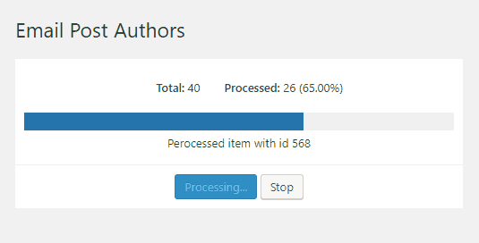

# WP Batch Processing

WP Batch Processing is WordPress plugin for creating batches of data and processing the the data items one by one. It allows you to define a batch and to process the queued batch items one by one. There is also option to resume/continue later in case your internet connection goes down.
 


To define a batch you just need to extend the class `WP_Batch` and later register it. Follow  the examples below to learn how.

The class provides the following attributes and methods 

* `$id` - Identifies the batch (must be unique),
* `$title` - Shown in the admin area,
* `setup()` - Method that you use it to fed your data with `WP_Batch_Item` instances,
* `process(WP_Batch_Item $item)` - Method that will be used to process each next item in the batch

```php

if ( class_exists( 'WP_Batch' ) ) {

	/**
	 * Class MY_Example_Batch
	 */
	class MY_Example_Batch extends WP_Batch {

		/**
		 * Unique identifier of each batch
		 * @var string
		 */
		public $id = 'email_post_authors';

		/**
		 * Describe the batch
		 * @var string
		 */
		public $title = 'Email Post Authors';

		/**
		 * To setup the batch data use the push() method to add WP_Batch_Item instances to the queue.
		 *
		 * Note: If the operation of obtaining data is expensive, cache it to avoid slowdowns.
		 *
		 * @return void
		 */
		public function setup() {

			$users = get_users( array(
				'number' => '40',
				'role'   => 'author',
			) );

			foreach ( $users as $user ) {
				$this->push( new WP_Batch_Item( $user->ID, array( 'author_id' => $user->ID ) ) );
			}
		}

		/**
		 * Handles processing of batch item. One at a time.
		 *
		 * In order to work it correctly you must return values as follows:
		 *
		 * - TRUE - If the item was processed successfully.
		 * - WP_Error instance - If there was an error. Add message to display it in the admin area.
		 *
		 * @param WP_Batch_Item $item
		 *
		 * @return bool|\WP_Error
		 */
		public function process( $item ) {

			// Retrieve the custom data
			$author_id = $item->get_value( 'author_id' );

			// Return WP_Error if the item processing failed (In our case we simply skip author with user id 5)
			if ( $author_id == 5 ) {
				return new WP_Error( 302, "Author skipped" );
			}

			// Do the expensive processing here.
			// ...

			// Return true if the item processing is successful.
			return true;
		}
		
		/**
		 * Called when specific process is finished (all items were processed).
		 * This method can be overriden in the process class.
		 * @return void
		 */
		public function finish() {
			// Do something after process is finished.
			// You have $this->items, etc.
		}
	}
}

```

After creating the class, class instance needs to be registered in order to be available in the batches list in the admin area.

```php
/**
 * Initialize the batches.
 */
function wp_batch_processing_init() {
    $batch = new MY_Example_Batch();
    WP_Batch_Processor::get_instance()->register( $batch );
}
add_action( 'wp_batch_processing_init', 'wp_batch_processing_init', 15, 1 );
```

That's it.

## Hooks

Set delay between processing items. Default is 0 (no delay)
```php
function wp_bp_my_custom_delay($delay) {
   return 2; // in seconds
}
add_filter('wp_batch_processing_delay', 'wp_bp_my_custom_delay', 10, 1);
```

## Example use cases

The tool can be used in many different ways. For example

* Importing data
* Downloading data
* Emailing
* Database modifications


## Contribute

If you notice a bug or you want to propose improvements feel free to create a pull request!


## Credits

Based on WP Batch Processing by Darko Gjorgjijoski.

Modified by UAMS Web Services.

Developers:

- Todd McKee
- Josh Daugherty

## Tests

The suite uses Pest 5 with Brain Monkey, so it needs no database and no WordPress checkout. It develops and runs on PHP 8.4.27 (`config.platform.php` in `composer.json`).

```bash
composer install
composer test
```

`composer test` runs `vendor/bin/pest` over `tests/Unit`. The shared local CI runner runs the same suite with the rest of the checks:

```bash
node .claude/skills/local-ci/local-ci.mjs
```

Name every test file `*Test.php`, or the suite does not pick it up.

### Code quality

Rector, PHPStan (with the WordPress extension and stubs) and Pint from the shared code-quality standard are development dependencies only, and each is a runner job and a Composer script:

| Tool | Check | Fix |
| --- | --- | --- |
| Rector | `composer test:refactor` | `composer refactor` |
| PHPStan | `composer stan` | raise `level` in `phpstan.neon.dist` one level per change |
| Pint | `composer test:pint` | `composer pint` |

PHPStan starts at level 0, the highest level the code passes today, and rises one level per change. The two Advanced Custom Fields functions the batches call are declared for it in `phpstan-stubs.php`.

### Reading the runner's verdict

The runner selects jobs from the branch's diff against `origin/master`, runs each on the local PHP toolchain, and ends with a summary block that names the validated commit and lists every job as `PASS`, `FAIL` or `SKIPPED`. A failing job fails the run: the exit status is non-zero exactly when the summary says a job failed, and the summary is what to read. Write the run to a file and read the block at the end:

```bash
node .claude/skills/local-ci/local-ci.mjs > ci.log 2>&1
```

`--jobs a,b` runs named jobs only and `--all` runs every job; the two exclude each other. The jobs live in `local-ci.json`. A pull request carries the runner's verdict as a comment naming the commit it validated.

### Remote CI

`.github/workflows/ci.yml` calls the shared chain in `UAMS-Web/uams-ci-workflows`, pinned to a release tag, and ends in the one job named `CI`. The repository is private, so the call and `CI` are gated on the Actions variable `RUN_REMOTE_CI`: set to `false`, they report `skipped` and use no minutes, and the local runner above is the whole gate. Unset, or any other value, runs the chain. A `skipped` job proves nothing. To take a newer chain, move the pin in `ci.yml` and pass only inputs the new tag declares.

### Pre-commit guard

`.githooks/pre-commit` refuses a commit that stages a file matching `guard.deny` in `local-ci.json` (a `wp-config.php`, a database dump, a spreadsheet export, an `.env`, a key). Git does not run a hook from the repository on its own, so each clone turns it on once:

```bash
git config core.hooksPath .githooks
```

The runner warns when the hook is tracked and `core.hooksPath` is unset.


## License

The plugin is licensed under GPL v2

### Modified version

This is a modified version of [WP Batch Processing](https://github.com/gdarko/wp-batch-processing) by Darko Gjorgjijoski. UAMS Web Services changed the plugin between 2020-07-21 (the first commit in this repository) and 2026-11-13 (the date of this notice), adding the Find-a-Doc batches under `fad/` and changing files under `includes/`, `views/` and `assets/`. The commit history of this repository records each change. The whole work stays under the GNU General Public License, version 2 or any later version; the full text is in [`LICENSE`](LICENSE).

Copyright (C) 2020-2026 UAMS Web Services (modifications)

The upstream copyright and license notice follows unchanged.

```
Copyright (C) 2019 Darko Gjorgjijoski (https://darkog.com)

This file is part of WP Batch Processing

WP Batch Processing is free software: you can redistribute it and/or modify
it under the terms of the GNU General Public License as published by
the Free Software Foundation, either version 2 of the License, or
(at your option) any later version.

WP Batch Processing is distributed in the hope that it will be useful,
but WITHOUT ANY WARRANTY; without even the implied warranty of
MERCHANTABILITY or FITNESS FOR A PARTICULAR PURPOSE.  See the
GNU General Public License for more details.

You should have received a copy of the GNU General Public License
along with WP Batch Processing. If not, see <https://www.gnu.org/licenses/>.
```